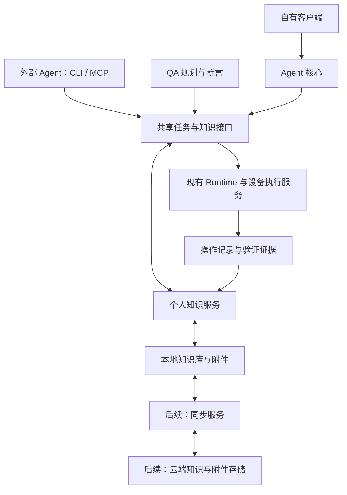

# 个人通用 Agent 与任务知识库规划

- 状态：审查草案，尚未进入实现。
- 创建日期：2026-10-16。
- 用途：保存本轮产品与技术讨论，作为后续审查、范围收敛和实施拆解的依据。
- 范围：本文记录已确认方向及候选方案；模块名称、接口、存储选型、阶段划分和验收门槛仍可调整。
- 当前交付：仅新增规划文档，不改变代码、用户安装环境、产品版本或发布状态。

## 1. 已确认的产品方向

| 编号 | 已确认方向 | 对规划的影响 |
| --- | --- | --- |
| D-01 | 目标是完整的个人通用 Agent 产品。 | 覆盖目标理解、规划、执行、结果验证、成果交付和经验积累。 |
| D-02 | 对重复出现的画面和任务，研究复用已验证操作，减少模型读图的成本和时间。 | 视觉动作复用是整体产品的一项基础能力。 |
| D-03 | CLI/MCP、桌面版、QA 三个入口共用底层能力，同步接入。 | 匹配、知识管理和执行校验只实现一套；不得为三个入口建立独立知识系统。 |
| D-04 | 建设个人任务知识库，积累实际执行经验。 | 知识要有任务语境、适用条件、来源、验证记录和生命周期。 |
| D-05 | 当前知识库可以保存在本地，后续需要考虑云端存储。 | 从首版设计身份、版本、存储接口与同步边界；云端部署时间和供应商尚未确定。 |
| D-06 | 本轮先形成文档，后续继续审查。 | 本文不构成对开发、迁移、上传数据、提交或发布的授权。 |

产品目标：用户提出目标后，Agent 使用获准的工具和设备完成任务，交付可检查的结果，并将经过验证的经验用于后续任务。

希望建立的产品特点是跨设备执行、个人经验积累和结果可核验。相近的通用 Agent 产品与工作流记忆研究已经存在，差异化和技术创新需要通过具体机制及实验验证。

## 2. 当前基础与能力缺口

以下是本轮代码和文档检查确认的基础，不代表所有平台均已通过本次真实设备验收。

| 现有基础 | 代码或文档 | 本需求中的作用 |
| --- | --- | --- |
| 共享设备操作、观察检查及输入记录 | [devices/service.py](saygo/devices/service.py)、[qa/control.py](saygo/qa/control.py) | 新能力继续复用执行边界。 |
| 交互任务、持久化、人工接管与不确定结果处理 | [runtime/interactive.py](saygo/runtime/interactive.py)、[runtime/store.py](saygo/runtime/store.py) | 保留现有任务恢复和资源归属语义。 |
| 桌面视觉决策循环 | [desktop/runner.py](saygo/desktop/runner.py) | 作为自有 Agent 核心演进的起点。 |
| QA 规划、逐步操作及断言 | [qa/agent.py](saygo/qa/agent.py)、[qa/brain.py](saygo/qa/brain.py) | 接入操作经验，保留测试判定语义。 |
| MCP 图像与动作接口 | [mcp/server.py](saygo/mcp/server.py) | 需支持先本地匹配，再决定是否返回图像。 |
| 稳定帧和像素差处理 | [vision/settle.py](saygo/vision/settle.py)、[性能说明](docs/common/performance.md) | 可复用部分图像处理基础；现有阈值不能直接当作动作复用条件。 |

本轮尚未发现完整的视觉动作知识库、可执行经验学习与复用服务，也未验证完整个人通用 Agent 产品或知识云同步能力。

完整产品仍需设计：通用规划、工具选择、文件与成果管理、个人资料检索、任务级验证、成本预算，以及后续的账号、同步和调度能力。

## 3. 用户任务与首版场景候选

建议使用具有明确交付物的任务形成首个端到端样例，例如：

> 从指定应用获取某个日期范围的数据，按用户提供的模板整理分析，生成报告并检查结果。

这是候选场景，尚未确定实际目标应用、平台、输入资料或验收设备。公开文档和测试样例使用通用名称及自有测试数据。

完整过程应包含：

1. 理解目标、输入参数、完成条件、用户指定的方法和授权范围。
2. 检索用户约束、相关资料、历史经验和流程。
3. 制定可执行计划，明确工具、设备、依赖、检查点及中断条件。
4. 逐步操作，观察结果；在授权范围内调整计划。
5. 检查业务结果与交付物，区分已完成、未验证和需要人工处理的部分。
6. 保存执行记录，生成或更新待验证的经验。

重复执行时应使用本次参数，复用适用的流程。界面或条件变化时，应明确退出复用并重新判断。用户中途接管或程序重启后，必须核对当前现场和已有执行记录后继续。

## 4. 目标架构与职责

### 4.1 产品分层

| 层 | 职责 | 约束 |
| --- | --- | --- |
| 用户入口 | 对话、附件、进度、人工接管和成果查看 | 不在界面中重复实现规划及设备分派。 |
| Agent 核心 | 目标理解、计划、工具选择、进度判断及失败恢复 | 每次运行明确规划负责人；遵守用户指定的方法和授权范围。 |
| 个人知识服务 | 记录、提炼、检索、版本和失效管理 | 三个入口共用；检索命中不等于执行获准。 |
| 工具与执行 | 设备操作，以及后续的文件、计算、搜索和应用连接能力 | 新工具范围待审查；继续复用现有执行守卫。 |
| 验证与交付 | 检查任务完成条件，管理文件、报告和业务证据 | 操作派发成功不能代替业务成功。 |
| 云端服务 | 后续账号、知识同步、调度及可选的远程执行 | 云存储、远程控制和云执行分别设计、分别验收。 |



### 4.2 三个入口与规划负责人

- 自有桌面版及未来客户端由 Agent 核心规划。建议从现有桌面 runner 提取可复用的规划逻辑，界面保留展示和交互职责。
- 外部 Agent 可以继续负责规划，通过 CLI/MCP 调用共享知识和执行能力。不能在每次设备操作中暗中启动另一个通用规划循环。
- QA 继续由用例和 QA 引擎控制步骤及断言；共享操作经验，不套用通用任务的完成声明替代测试判定。
- 相同任务语境、画面和适用条件，应通过相同的知识服务得到一致的复用判断；各入口仍有各自明确的结果语义。

Agent 核心位于 Runtime 之上。Runtime 继续管理持久化、资源、执行和恢复，不在内部另建模型决策循环。现有 CLI/MCP 默认行为如何兼容，由后续接口审查决定。

### 4.3 建议新增的知识模块

候选目录为 `saygo/knowledge/`，尚未创建。建议职责包括：

- 数据模型与结构迁移。
- 经验记录及来源事件摄取。
- 任务和视觉候选检索。
- 适用条件检查、匹配与复用决策。
- 从经历提炼参数化流程。
- 版本、禁用、失效、删除和导入导出。
- 存储接口和后续同步适配。

上述模块不复制平台驱动、请求去重、资源锁或错误处理。

## 5. 个人知识的结构

### 5.1 知识分类

| 类别 | 内容 | 使用边界 |
| --- | --- | --- |
| 用户明确约束 | 指定方法、偏好、禁用操作、需要确认的环节 | 历史行为不能自动覆盖明确约束或扩大授权。 |
| 工作资料 | 文档、模板、术语、项目背景及来源 | 记录所有者、版本和适用范围。 |
| 执行经历 | 任务、前后截图、动作、结果、异常及人工接管 | 实际事实与 Agent 注释分开保存。 |
| 页面状态 | 视觉特征、目标身份、相关任务上下文 | 相同像素不保证相同业务状态。 |
| 可复用流程 | 参数、步骤关系、前置条件、动作和后置检查 | 每次执行使用当前参数和当前目标绑定。 |
| 失败经验 | 失败条件、混淆画面、修正记录 | 用于拒绝不适用经验和降低重复错误。 |

### 5.2 三类数据必须分离

1. **经历与证据**：记录实际发生的事实，可被知识引用；修订知识不能改写原执行事实。保留期限和隐私删除策略另行定义。
2. **流程知识**：从经历提炼出的可复用方法，具有独立修订版本。
3. **运行状态**：当前 session、observation、pending action、request ID 和资源锁，由现有运行时管理。

知识云同步不传递设备控制权，也不能将另一台设备的运行状态直接恢复为当前绑定。

### 5.3 建议的数据字段

| 字段组 | 内容 |
| --- | --- |
| 身份与归属 | 稳定知识 ID、个人或工作区范围、来源设备 ID |
| 版本 | 数据结构版本、知识修订 ID、父修订、状态 |
| 意图与参数 | 任务类别、步骤标识、参数声明、允许替换的字段 |
| 适用条件 | 应用与平台范围、当前目标、显示配置、相关账号范围、依赖状态 |
| 视觉依据 | 解码像素指纹、候选模板、必要检查区域、图像尺寸及坐标映射 |
| 操作 | 动作模板、必要能力、每步执行前检查 |
| 验证 | 后置条件、验证方式、证据引用、验证来源和时间 |
| 来源与统计 | 来源任务及事件、成功和失败记录、最近适用性检查 |
| 同步 | 同步状态、独立事件 ID、删除或禁用记录 |

本地独立使用时也生成稳定身份，未来可关联云端账号。结构字段是候选协议，需审查后冻结。

### 5.4 操作规则示例

```text
任务：导出报表
参数：日期范围、导出格式

前置条件：
  当前目标属于指定应用
  当前页面符合报表页面规则
  日期和格式已设置为本次参数

动作：
  点击在当前截图中通过规则确认的导出入口

后置检查：
  检查声明的导出结果
  保存实际检查方式与证据

中断条件：
  需要登录、目标不明、未知弹窗、执行结果未知

来源：
  来源执行事件、验证记录、已知失败条件
```

多条规则通过顺序、分支和依赖关系形成流程。流程中的文字描述不能自动充当可执行检查器；无法落实为本地检查的条件，必须交给模型、人工或已声明的程序验证。

## 6. 经验学习与生命周期

### 6.1 学习链路

1. 从持久化执行记录摄取事实，使用来源事件 ID 去重。
2. 关联任务意图、当前步骤和参数。
3. 将结果未知、证据不足的记录保留为经历，不晋升为可执行知识。
4. 提取固定操作，声明可变参数、适用条件、检查点和中断条件。
5. 建立候选知识，使用独立样本与混淆样本检查适用范围。
6. 达到确定的准入规则后启用；出现反例时暂停受影响版本。

已有日志没有足够任务上下文时，不得臆造意图或验证结果。知识摄取失败可以从来源记录恢复，不得因此重新派发业务操作。

流程归纳可以在任务结束后进行，不阻塞当前操作。首版无需训练个人模型。归纳若使用云端模型，需要明确传输范围，并将推理成本计入总成本；知识本地保存不等于整个学习过程离线。

### 6.2 生命周期候选

`已记录 → 待验证 → 可复用 → 暂停使用／失效`

- 操作派发成功不等于验证完成。
- 程序检查、模型判断和人工确认分别记录来源，不能相互冒充。
- 单纯累计成功次数不足以证明泛化能力；必须检查新参数和容易混淆的场景。
- UI 更新或错误只影响部分步骤时，保留其他版本及其证据，是否局部复用由依赖检查决定。
- 用户可以查看、纠正、禁用和删除知识；被删除证据支撑的流程需要重新评估可用性。
- 自动启用条件、人工审查条件和失效阈值尚未确定。

## 7. 视觉动作复用机制

### 7.1 首版建议采用精确匹配

匹配对象为“本次任务语境＋当前目标与状态＋新截图”，不以图片单独决定动作。

建议顺序：

1. 根据任务、步骤、平台和适用范围过滤候选。
2. 获取新的有效 observation，核对目标、图像尺寸和坐标映射。
3. 对规范化解码后的像素生成指纹；命中后核对像素及上下文。
4. 检查当前参数、所需能力、授权及已派发记录。
5. 将动作绑定到当前 observation，通过原执行入口派发。
6. 再次观察，按当前任务要求验证结果并记录经验。

原图文件的编码或元数据可能不同，首版以解码像素为比较对象。首版不默认忽略页面区域；精确匹配的真实命中率需要测量。

### 7.2 后续增强候选

- 明确声明动态区域，并验证忽略该区域不会漏掉关键条件。
- 对目标区域和周边布局匹配，处理受控范围内的位置变化。
- 使用图像或文字向量寻找候选，再通过明确规则检查。
- 对已知流程中的未知步骤，单独交给模型处理。
- 支持有步数和时间上限的本地连续执行，每一步重新截图并检查；遇到未知状态立即停止复用。

现有 settle 使用的缩图、顶部遮罩和变化阈值不直接用于动作许可。全屏高相似度可能掩盖按钮文字、金额、勾选或弹窗变化。

### 7.3 必须保留的执行语义

- 使用当前目标绑定和新 observation，不能重用旧观察 ID。
- 相同步骤已派发后，画面未变化不能自动触发重复动作。
- 结果未知保持 `needs_review`；核对、resolve 和新观察后才能决定后续动作。
- 暂停和停止在复用路径中同样有效；缓存命中不能绕过人工接管。
- 本次输入值来自当前参数；凭据通过本机凭据机制引用，不复制历史密码或消息。
- 新页面、窗口、设备或显示映射变化须重新确认适用性，不暗中换目标。
- 动作复用不能直接复用 QA PASS、旧完成证据或业务成功结论。
- 图像变化只能提供观察事实；不可视的业务结果需要相应的程序验证。
- 视觉决策不向模型提供 DOM 或 UI 树。新增文件、计算或应用接口能力按独立工具设计，不改变视觉操作协议。
- 资源锁不保证用户或其他软件不会改变界面；仍需执行前校验和执行后检查。

## 8. 共享接口与成本边界

### 8.1 入口提供的语境

共享服务至少需要：任务目标、步骤或流程引用、当前参数、目标范围、当前 observation、完成条件和已有授权引用。

- QA 提供用例与步骤语境。
- 自有 Agent 提供目标、计划与当前步骤。
- 外部 Agent 通过 CLI/MCP 提供语境，或明确调用已有流程。
- 没有充分语境时可以记录操作，但不得静默生成通用自动执行规则。

### 8.2 概念接口

以下仅为职责示意，不是现有命令或已确定的公开 API：

| 操作 | 作用 |
| --- | --- |
| 查询候选 | 返回相关经验和适用范围，不产生输入。 |
| 检查复用条件 | 返回命中、未命中、歧义、阻塞及其依据。 |
| 执行已选流程 | 在本次授权内调用原执行链路，返回逐步记录。 |
| 记录结果 | 关联派发事实、后续观察及验证证据。 |
| 提炼候选 | 从已记录事实生成待验证知识。 |
| 管理知识 | 查看、修订、禁用、删除及导入导出。 |

### 8.3 外部 Agent 的成本优化

CLI/MCP 必须支持先在本地匹配，再决定是否返回图片。若先将截图送给模型，再查询缓存，本轮读图成本已产生。

命中后可以返回结构化执行记录；未命中、出现歧义或需要视觉验证时返回当前图像及原因。需要同步审查工具协议和共享 device Skill，不能直接破坏现有 observe 接口的语义。

外部 Agent 的单步文本往返及历史图像上下文仍可能产生费用。只有在明确调用受约束流程时，才能进一步减少多个动作间的模型往返。不得将“省掉一次新图像返回”表述为“总模型费用归零”。

## 9. 本地存储与后续云端能力

### 9.1 本地实现候选

建议采用 SQLite 保存结构化知识、关系及变更队列，使用本地文件保存图像和附件。统一存储接口隔离具体后端。

候选位置为 `$SAYGO_HOME_DIR/knowledge`，实际路径和与项目知识范围的关系待审查。知识数据、截图和真实输入不得进入公开源码或发布包。

### 9.2 云端存储与同步

建议云端通过知识 API 管理结构化记录，通过对象存储管理附件。每台设备保留本地副本，匹配和执行不要求每一步访问云端。

| 数据 | 同步建议 |
| --- | --- |
| 流程、参数和适用条件 | 按稳定 ID 与修订版本同步。 |
| 执行及验证记录 | 使用独立事件 ID 去重追加，遵守用户的保留和上传范围。 |
| 截图、模板和附件 | 与元数据分离；上传范围由明确的数据策略控制。 |
| 本机路径、窗口、页面、会话和 observation ID | 作为来源信息引用；在新设备重新绑定，不能直接执行。 |
| 凭据 | 不进入知识正文或普通附件；执行时通过相应凭据机制获取。 |
| pending action、执行锁和控制权 | 留在实际执行端；知识同步不迁移这些状态。 |

同步机制候选：

1. 知识变更与本地同步队列在同一事务内提交。
2. 上传和下载按事件 ID 幂等处理，断网后可继续同步。
3. 流程修订生成新版本；并发修改保留分支，不自动拼接未经验证的动作序列。
4. 禁用和删除具有独立记录，防止旧副本重新上传后复活。
5. 一次执行固定流程版本；新版本用于后续运行。运行中的禁用如何响应另行定义。
6. 缺失视觉附件或平台不兼容时，返回不可复用并重新学习。
7. 用户和工作区范围在服务端强制校验，传输、存储和访问控制纳入云端验收。

离线设备不能即时获知云端撤销。需进一步确定撤销传播、过期策略，以及哪些流程需要在线复核。云端不可用时，已同步且仍适用的经验可以本地使用；未知步骤若依赖云端模型，仍需模型连接。

### 9.3 三项云端能力分别建设

- **知识同步**：多设备使用同一份个人知识。
- **任务协同**：从不同入口发起任务，交给明确绑定且在线的设备执行。
- **云端执行**：在受管理的远程环境运行适合该环境的任务。

云端保存知识不自动授权远程控制设备。远程任务需要独立设计执行者归属、连接、授权、取消和结果不明时的恢复协议，不能通过任务消息重发造成重复输入。

## 10. 候选技术创新与研究边界

已有研究覆盖工作流记忆、图结构经验和可执行 GUI 记忆。因此，下列内容是待验证方向，不是原创性或性能结论。

| 候选方向 | 研究问题 | 验证重点 |
| --- | --- | --- |
| 任务相关的视觉检查条件 | 如何从正例、反例和纠正中学习每一步必须检查的区域与上下文？ | 在同等错误复用率下提高可复用覆盖率；不能仅提高全屏相似度。 |
| 带证据的经验生命周期 | 如何晋升可靠经验，并在 UI、参数或业务条件变化时及时失效？ | 错误经验是否被传播；失效是否及时；是否保留来源和可撤销版本。 |
| 按验证成本选择路径 | 何时本地匹配、何时局部读图、何时完整规划？ | 将学习、匹配、验证、回退的成本一并计入总成本。 |
| 跨入口和设备复用 | 如何共享任务知识，同时保持平台动作与目标绑定准确？ | 不假定跨平台坐标通用；入口一致性与真实平台兼容性分别验证。 |

研究资料（本轮已查阅，结论以各论文范围为限）：

- [工作流记忆与复用](https://arxiv.org/abs/2409.07429)：从经验提炼流程并用于后续任务。
- [GUI 可执行记忆与图结构规划](https://arxiv.org/abs/2605.12294)：结构化经验用于检索与执行。
- [带视觉重新定位的可重放执行记忆](https://arxiv.org/abs/2609.16635)：参数、前置条件、视觉证据和验证来源共同约束复用。
- [面向新任务的逐步经验复用](https://arxiv.org/abs/2610.11707)：根据页面一致性及动作参数选择复用、替换或回退。

论文报告的收益不能作为本项目收益承诺。同类产品的内部实现无法仅凭公开功能说明确定，后续对照应区分公开事实与推断。

## 11. 建议实施顺序

以下阶段是审查建议，无开发日期、工时或版本承诺。各阶段涉及的共享能力都应覆盖三个入口，不能把入口一致性留到最后补齐。

| 阶段 | 主要交付 | 完成条件 |
| --- | --- | --- |
| P0：范围与协议 | 确定首个用户任务、语境协议、知识结构、基准与验收目标 | 对现有完成率、耗时、调用量和成本有可复查基线。 |
| P1：本地任务闭环与单步复用 | 复用现有 runner/Runtime，形成完整样例；共享记录、精确匹配和知识管理 | 三个入口接入同一服务；命中、未命中及未知结果语义正确。 |
| P2：参数化流程与个人资料 | 流程提炼、检查点、生命周期、资料检索和必要的新工具 | 新参数重复任务能复用；界面变化和混淆样本能阻止错误复用。 |
| P3：云端知识 | 账号范围、附件、增量同步、冲突和删除处理 | 多设备、断网重连、权限隔离及删除传播验收通过。 |
| P4：任务协同与云端执行 | 独立评估调度、远程执行环境及设备任务协同 | 不重复派发，控制权明确，结果与恢复证据完整。 |

P1 要体现完整个人 Agent 的用户价值；视觉缓存是其中的实现能力。后续通用性按明确场景扩展，不以一次演示推断任意任务可用。

## 12. 验收与收益测量

### 12.1 功能与异常场景

| 场景 | 要检查的结果 |
| --- | --- |
| 首次任务 | 能理解目标、执行、验证并交付，记录真实成本。 |
| 相同任务与画面 | 命中时实际省去动作决策的视觉调用。 |
| 新参数重复任务 | 使用本次值，不沿用旧账号、日期、消息或表单值。 |
| 同图不同意图或步骤 | 不串用动作。 |
| 相似页面、按钮变化、弹窗、缩放 | 拒绝不适用经验，返回当前观察。 |
| 操作后画面不变 | 不因再次匹配而自动连点。 |
| 超时、崩溃、响应丢失 | 通过原请求记录核对，不自动重放未知输入。 |
| 人工接管与恢复 | 暂停阻止操作，恢复后新观察，验证任务进度。 |
| 旧页面或窗口失效 | 明确重新选择，不暗中替换目标。 |
| QA 断言与业务结果 | 不复用旧 PASS，不将派发或像素变化当作业务成功。 |
| 三个入口 | 共享知识和复用规则，各自保持正确结果语义。 |
| 缓存损坏或证据缺失 | 明确退出复用；不妨碍检查现有任务状态。 |
| 云同步与冲突 | 去重、断点恢复、版本冲突、禁用和删除处理可验证。 |
| 新设备 | 重新绑定目标，检查能力及模板，不能直接使用旧坐标和运行状态。 |

### 12.2 对照设计

至少比较：关闭复用、精确匹配复用、增强流程复用。对照使用相同任务、设备、模型与起始条件，同时包含首次学习、后续重复、未见参数和界面变化。

指标包括：

- 任务完成率、结果验证质量、人工介入次数。
- 复用覆盖率、错误复用率、错误动作次数、回退和失效情况。
- 端到端耗时及高分位耗时。
- 模型调用量、图像输入、实际用量和费用；不把调用次数直接等同于费用。
- 知识提炼、匹配、结果验证、同步及失败恢复的额外开销。
- 重复次数增长时的累计成本，以及知识库增长后的检索性能。

净收益需扣除学习和维护开销。不能只测相同截图的命中耗时，也不能仅在成功任务中统计提速。

阈值和样本规模待 P0 确定。离线单元/契约测试、模型模拟和真实设备测试分开记录。Windows、macOS、Android、iOS、浏览器扩展和 Playwright 按实际受影响范围分别验收；没有证据的路径标记未验证。

## 13. 下一轮待审查问题

| 编号 | 优先级 | 问题 | 当前状态 |
| --- | --- | --- | --- |
| R-01 | P0 | 首个用户任务、目标用户、设备和交付物是什么？ | 报表任务仅为候选。 |
| R-02 | P0 | 首版 Agent 核心需要哪些文件、计算、搜索或应用工具？ | 待定义；不默认新增全部工具。 |
| R-03 | P0 | 任务意图、步骤、参数和验证条件如何由三个入口统一提供？ | 待确定协议与兼容方式。 |
| R-04 | P0 | 什么证据允许经验晋升？哪些操作允许自动复用？ | 待确定分级规则和准入条件。 |
| R-05 | P0 | 如何限制总时间、模型费用及自动恢复范围？ | 待确定任务级预算和停止语义。 |
| R-06 | P0 | 首版如何检查完成条件和实际交付物？ | 需随场景定义，不能只依赖自然语言完成声明。 |
| R-07 | P1 | 用户约束、项目资料、个人经验的作用域和冲突如何处理？ | 待定义优先级、来源和管理界面。 |
| R-08 | P1 | 本地知识的保留、压缩、删除和敏感内容处理如何实施？ | 待定义；不进入公开仓库及构建产物。 |
| R-09 | P1 | 界面变化时，哪些部分可继续复用，哪些必须重新学习？ | 待定义依赖与失效规则。 |
| R-10 | P1 | 默认匹配模式、审计模式和对用户的可解释信息是什么？ | 候选为关闭、仅记录、启用复用。 |
| R-11 | P2 | 云同步上传范围、加密与密钥管理、多端冲突如何处理？ | 云端存储方向已确认，具体方案待审查。 |
| R-12 | P2 | 离线撤销、运行中禁用、跨设备接续的边界是什么？ | 不假定同步即可完成控制权迁移。 |
| R-13 | P2 | 何时建设任务调度和云端执行？ | 属于后续产品范围，尚未排期。 |
| R-14 | P0 | 每阶段的验收阈值、样本规模及真实平台覆盖是什么？ | 待测量基线后确定。 |

## 14. 审查记录

| 日期 | 记录 | 结论 |
| --- | --- | --- |
| 2026-10-16 | 汇总产品目标、视觉动作复用、个人知识及未来云端方向 | 第 1 节为已确认方向；其余为待审查设计。尚未实现或性能实测。 |

后续审查在此记录结论，并同步修订对应正文；保持已确认决策、候选方案和实际实现状态可区分。
